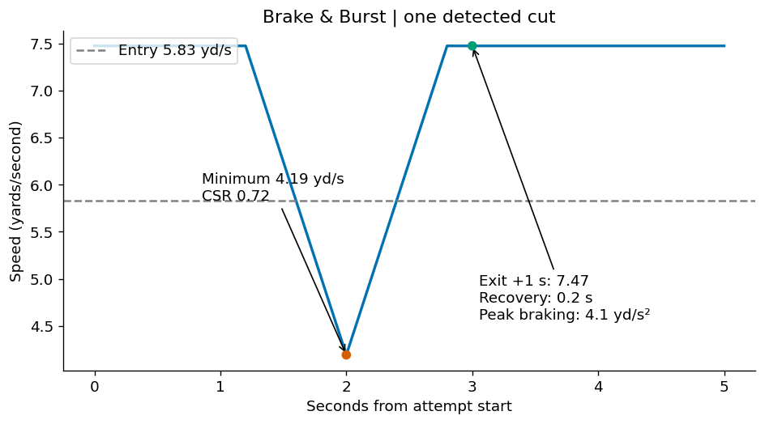
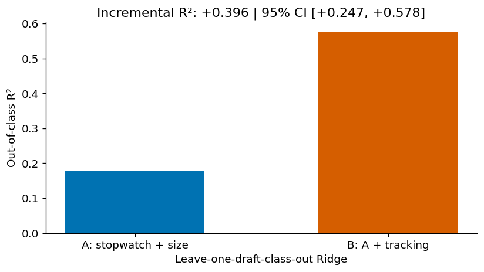
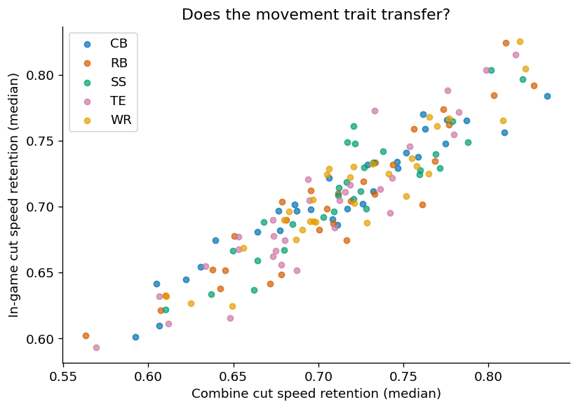
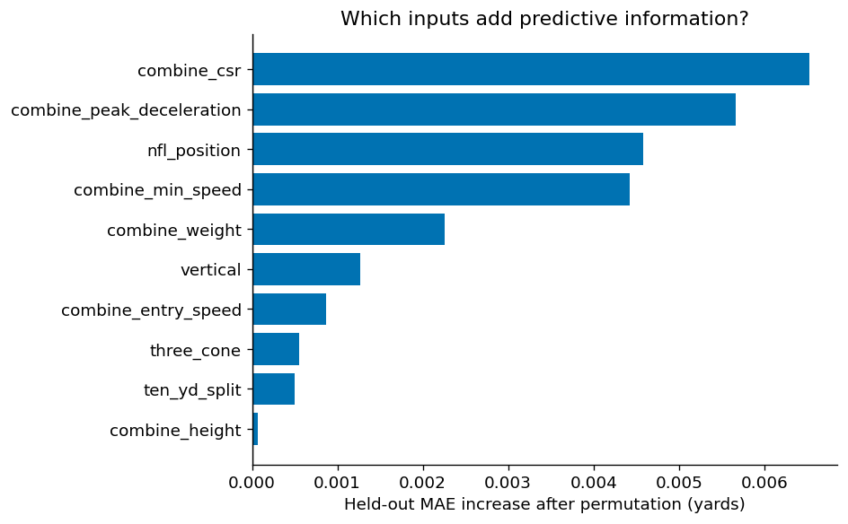
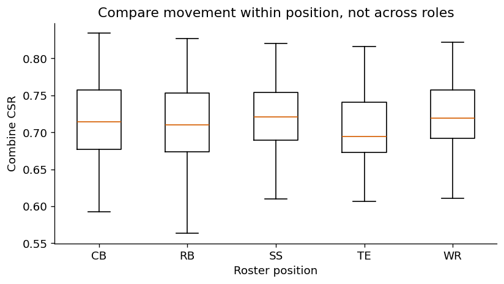

# Brake & Burst: what stopwatch times hide

> **{{status}}.** No competition observations were available during development. Synthetic results below demonstrate an executable method, not scouting evidence. Regenerate on licensed competition data, inspect diagnostics, and replace the public-notebook link before submitting. Artificial signal was deliberately planted; recovery of that signal is not external validation.

## Introduction / question

Can route runners preserve useful speed through a break even when their stopwatch times look ordinary? Brake & Burst separates braking, retention and reacceleration rather than treating agility as a single elapsed time. The primary predictive analysis concerns WR and TE separation; RB and defensive backs provide descriptive movement comparisons, not interchangeable outcome models.

## Data & metric definition

The linked tables contain prospect metadata, conventional Combine tests, optical Combine tracking, game tracking, player-play context and career outcomes. This run includes {{regular_player_plays}} regular-season player-play observations. Playoffs and nullified plays are excluded from game analysis. Career starts and active games are documented regular-season counts; career snap totals include playoffs and are deliberately not used as regular-season snap shares.

A cut requires a local speed minimum with measurable prominence, sufficient incoming speed, and a circular direction change exceeding the specified threshold over a short window. Only route/transition skill drills, shuttle and cone drills contribute. Each cut records entry speed, minimum speed, exit speed one second later, peak braking, time to recover most incoming speed and **CSR = minimum / entry speed**. Lower braking losses need not mean better technique: a sharper cut mechanically demands more braking. Compare like routes and turning angles before coaching intervention. Median and interquartile range summarize repeated cuts; missing recovery remains missing rather than falsely indicating success.

Forty-yard tracking adds peak speed, time to near-maximum speed and peak acceleration. Game cuts use precisely the same extractor, restricted to snap-through-pass-forward route windows; DB movement windows are secondary. Filtered tracking is streamed into player partitions so chunk boundaries and interleaved player frames cannot split cuts. This run detected {{combine_cuts}} Combine cuts and {{game_cuts}} game cuts.

## Methods / validation

Targeted separation is residualized against route, man/zone coverage, cushion, down and distance. The context model is fit only on training players inside each outer fold. Player residual means are shrunk toward training-position means, stabilizing sparse targets. Players without sufficient targets are not ranked. Receiving yards per route, EPA per target, tackles per snap, starts per active game and regular-season snaps per season are exported as descriptive outcomes. A fixed team-opportunity denominator gives an explicitly labelled snap-share **proxy**, not an observed share.

Baseline A uses traditional Combine tests, size and position. Model B adds cut medians, cut consistency and sprint features. Draft-adjusted variants impute undrafted status at a late-pick reference. Ridge and gradient boosting regressors are evaluated alongside logistic and boosting starter classifiers. Starter means starting at least half of active games. NFL features never enter predictor columns.

Leave-one-draft-class-out validation is primary. Repeated stratified folds are a stability check, not an independent chronological test. Preprocessing and context adjustment are refit within every fold. CSV exports include every fold's regression R², Spearman and MAE, and classification ROC-AUC and Brier score. Paired player bootstrap intervals describe conditional prediction uncertainty, not the uncertainty of retraining or new draft eras. Held-out permutation importance measures MAE degradation; correlated features can divide importance.

## Results

For {{n_players}} eligible WR/TE players, out-of-class Ridge R² is **{{a_r2}} for A versus {{b_r2}} for B**. MAE is **{{a_mae}} versus {{b_mae}} yards**, and Spearman is **{{a_rho}} versus {{b_rho}}**. The paired bootstrap interval for B minus A R² is **{{ci}}**. Negative improvements are possible and must not be concealed on real data.

Combine and game CSR have Spearman correlation **{{rho}}** across **{{translation_n}}** players with both measurements. This synthetic association is expected from a shared latent agility variable; it is an engineering check, not proof that Combine movement predicts NFL success.

Position distributions are descriptive: physical role, drill selection and route mix may explain apparent differences.

The following review queue compares out-of-class tracking predictions with out-of-class draft-only expectations. Surplus is in residual-separation yards, not an estimate of draft value. The reverse queue is exported as `outputs/bust_risk.md`; neither queue should become a definitive player label.

{{talent_table}}

## Football applications

**Draft room:** start with within-position, similar-angle cuts. When stopwatch and retention disagree, review synchronized film for foot placement, rounding and sensor error. Add football-role and medical context before moving a grade; tracking is a flag for inquiry, not a replacement for scouting.

**Development:** distinguish a player who brakes efficiently but rebuilds speed slowly from one who loses too much speed entering a break. Prescribe controlled deceleration mechanics or short reacceleration repetitions accordingly, then retest under matched approach speeds and angles. Do not reward rounded routes simply because CSR rises.

**Weekly practice:** compare route-family cut profiles against the coming opponent's coverage style. Use route timing and exit-speed mismatches to prioritize film and practice repetitions. Monitor consistency rather than prescribing a universal retention target. A team should test whether a drill intervention improves matched game cuts before claiming development success.

## Limitations

Synthetic trajectories omit collisions, occlusion, coverage interactions and many realistic missingness mechanisms. Signal strength and cohort composition were chosen, not discovered. Available target-level separation invites selection bias: a quarterback's decision affects which observations exist. Context residualization is predictive adjustment, not causal identification. Career opportunity depends on injuries, team depth and draft capital; cohorts have unequal follow-up. Regular-season snap shares cannot be recovered exactly without team snap denominators. Route windows without both milestone events and cuts lacking a full exit window are excluded, potentially favoring longer-developing plays. Tracking participation and recovery censoring need audit on real files. Frame derivatives amplify noise; sensitivity to cut angle, smoothing and recovery definitions remains future work. Only a few draft cohorts constrain transportability. Reported bootstrap intervals do not account for all model-selection uncertainty. DB coverage quality and RB receiving utility require dedicated outcomes before extending the predictive claims.

## Appendix / reproducibility

[Executed, self-contained notebook](analysis.ipynb). **Public Kaggle notebook URL: pending manual publication; submission is not complete without it.** Full fold metrics, feature tables, prediction audits and review queues are in `outputs/`. The pipeline regenerates this report directly from its measured outputs. Competition source: [NFL Big Data Bowl 2027](https://www.kaggle.com/competitions/nfl-big-data-bowl-2027); competition data is CC BY-NC 4.0, separate from the MIT code license.
